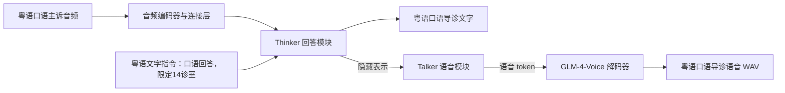

# 粤语AI语音导诊

**更新时间** 2026-11-25

**更新人** 傅昱

## 技术方案

**DialectS2S 粤语口语文字与语音导诊。** 输入为病人粤语口语主诉语音＋粤语文字指令，要求用粤语口语回答，并将推荐限制在既定 14 个诊室。模型输出相互对应的粤语口语文字和粤语口语语音。音频编码器先提取连续语音特征，经连接层送入 Thinker，与指令嵌入一起处理；Talker 根据 Thinker 的隐藏表示生成语音 token，再由 GLM-4-Voice 解码器转成 WAV。**Built with glm-4**。

**两阶段双模块 LoRA 方案（待实施）。** 两阶段均更新 Thinker 和 Talker 的 LoRA，基础权重、语音编码及输入投影、语音 tokenizer 与波形解码模块冻结。第一阶段使用标准粤语口语文字及配音，以文字与语音 token 交叉熵联合训练；第二阶段用第一阶段模型在训练集生成并审核的新回答及配音进行自对齐，以语音损失沿可微隐藏表示路径更新两组 LoRA。外部 TTS 仅离线制作监督，测试时模型自身生成文字和语音。具体注入层和超参数在实施时核对。[完整技术方案](docs/技术方案.md) · [已有模型与加载说明](models/README.md)

**本次方案文件。** [Word](docs/粤语AI语音导诊方案.docx) · [PPT](docs/粤语AI语音导诊方案.pptx)。本次更新为方案说明；既有数据内容、结构与训练/验证/测试划分保持不变，以下历史实验不代表新两阶段方案的结果。

| 对照模型 | 训练方式 |
| --- | --- |
| A | 原始 DialectS2S，未经本项目任务适配 |
| B | 第一阶段联合监督微调 |
| C | 从 B 完成第二阶段自对齐 |
| D | 从同一个 B 继续等量优化步数的普通第一阶段 SFT |

C、D 匹配新增优化步数、有效批大小和学习率计划，记录实际样本数、语音时长及目标 token 数。四组使用同一既有测试划分，分别评价诊室推荐、粤语口语文字、语音质量、文字语音一致性与联合正确性。另列 1400/2800/5600/6400 条嵌套训练子集的独立第一阶段实验，**暂不实施**。

## 已发布模型与历史实验（2026-11-19）

- **DialectS2S 原模型与双模块 LoRA 微调版。** 原模型和语音解码器共约 22.58 GB，分 43 卷。微调版共用原模型，并加载约 10.9 MB 的两组 LoRA 适配器。[模型下载](https://github.com/JocyRose/AI-CantoTriage/releases/tag/dialects2s-dual-lora-20261119) · [校验与恢复](models/README.md)
- **14 科小样本测试结果。** 本轮训练、验证和测试分别使用 42、14 和 28 条样本，输入音频均为 TTS 合成。两个模型使用同一批测试样本和同一条限定 14 科的指令。逐条报告包含两组文字、56 份模型生成语音及对应 ASR 转写。[实验说明](experiments/DialectS2S_dual_lora_20261119/PUBLICATION.md) · [逐条对照](experiments/DialectS2S_dual_lora_20261119/evaluation/test_comparison.md)

| 指标（每组 28 条） | 原模型 | 双模块 LoRA |
| --- | ---: | ---: |
| Agent 核对的文字科室标签命中 | 14/28（50.00%） | 15/28（53.57%） |
| 严格格式及 14 科原名通过 | 22/28（78.57%） | 28/28（100%） |

部分命中科室的回答仍存在理由不符的情况。语音准确率和文字语音联合准确率待真人试听后评定。

## 下一步

- 逐条复核本轮推荐理由和 56 份输出语音，检查粤语发音、可懂度及文字与语音的一致性。
- 继续清洗和复核粤语导诊数据，补充辅助检查科、营养保健科及用于转人工判断的急诊样本。
- 目标规模约 8000 个病例样本；完成口语文字与配音审核后，按两阶段方案训练并比较 A/B/C/D。第二阶段仅复用训练病例生成派生监督，不使用验证或测试输入制作训练目标。

## 前几个版本

- **2026-11-18** 补齐 84 条粤语导诊回复音频，与主诉音频配成 84 对。[主诉清单](数据集/84条粤语语音音频%3A云端TTS更新/input/manifest.jsonl) · [回复清单](数据集/84条粤语语音音频%3A云端TTS更新/output/manifest.jsonl)
- **2026-11-17** 为 84 条粤语主诉生成 WAV，沿用 42 条训练、14 条验证和 28 条测试的划分。[主诉音频](数据集/84条粤语语音音频%3A云端TTS更新/input)
- **2026-11-16** 整理 14 科共 84 条粤语文本小样本，采用自然语言导诊回复。[文本样本](数据集/Step-Audio-2-mini_14科_84条)
- **2026-11-13 至 11-14** 上传 LCMDC 中文抽样、webMedQA 补充候选和首批清洗改写的粤语导诊数据，同期发布未训练的语音—文本融合初始化。[数据目录](数据集) · [融合初始化](融合模型/README.md)
- **2026-10-31 至 11-03** 发布文本导诊 LoRA 及 Windows、macOS 可重组模型。同提示词复测中，原模型和 LoRA 的科室完全命中分别为 33/99 和 76/99。[文本模型](导诊模型/Qwen3-1.7B-windows-mac-compatible/README.md)
