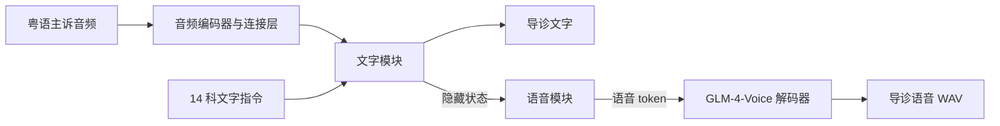

# 粤语AI语音导诊

**更新时间** 2026-11-19

**更新人** 傅昱

## 技术方案

**DialectS2S 语音与文字导诊。** 模型同时接收粤语主诉音频和限定 14 个科室的文字指令。音频编码器先提取连续语音特征，经连接层送入文字模块，与指令嵌入一起处理。模型分段交替生成文字和语音，语音模块根据文字模块的隐藏状态生成语音 token，再由 GLM-4-Voice 解码器转成 WAV。**Built with glm-4**。

**双模块 LoRA 微调。** 文字模块和语音模块各加载一组 LoRA。训练把文字预测损失与语音 token 预测损失相加，通过同一次反向传播更新两组适配器，底座权重保持冻结。独立 ASR 用于评测时转写输出 WAV。[模型与加载说明](models/README.md)

## 本次上传

- **DialectS2S 原模型与双模块 LoRA 微调版。** 原模型和语音解码器共约 22.58 GB，分 43 卷。微调版共用原模型，并加载约 10.9 MB 的两组 LoRA 适配器。[模型下载](https://github.com/JocyRose/AI-CantoTriage/releases/tag/dialects2s-dual-lora-20261119) · [校验与恢复](models/README.md)
- **14 科小样本测试结果。** 本轮训练、验证和测试分别使用 42、14 和 28 条样本，输入音频均为 TTS 合成。两个模型使用同一批测试样本和同一条限定 14 科的指令。逐条报告包含两组文字、56 份模型生成语音及对应 ASR 转写。[实验说明](experiments/DialectS2S_dual_lora_20261119/PUBLICATION.md) · [逐条对照](experiments/DialectS2S_dual_lora_20261119/evaluation/test_comparison.md)

| 指标（每组 28 条） | 原模型 | 双模块 LoRA |
| --- | ---: | ---: |
| Agent 核对的文字科室标签命中 | 14/28（50.00%） | 15/28（53.57%） |
| 严格格式及 14 科原名通过 | 22/28（78.57%） | 28/28（100%） |

部分命中科室的回答仍存在理由不符的情况。语音准确率和文字语音联合准确率待真人试听后评定。

## 下一步

- 逐条复核本轮推荐理由和 56 份输出语音，检查粤语发音、可懂度及文字与语音的一致性。
- 继续清洗和复核粤语导诊数据，补充辅助检查科、营养保健科及用于转人工判断的急诊样本。

## 前几个版本

- **2026-11-18** 补齐 84 条粤语导诊回复音频，与主诉音频配成 84 对。[主诉清单](数据集/84条粤语语音音频/input/manifest.jsonl) · [回复清单](数据集/84条粤语语音音频/output/manifest.jsonl)
- **2026-11-17** 为 84 条粤语主诉生成 WAV，沿用 42 条训练、14 条验证和 28 条测试的划分。[主诉音频](数据集/84条粤语语音音频/input)
- **2026-11-16** 整理 14 科共 84 条粤语文本小样本，采用自然语言导诊回复。[文本样本](数据集/Step-Audio-2-mini_14科_84条)
- **2026-11-13 至 11-14** 上传 LCMDC 中文抽样、webMedQA 补充候选和首批清洗改写的粤语导诊数据，同期发布未训练的语音—文本融合初始化。[数据目录](数据集) · [融合初始化](融合模型/README.md)
- **2026-10-31 至 11-03** 发布文本导诊 LoRA 及 Windows、macOS 可重组模型。同提示词复测中，原模型和 LoRA 的科室完全命中分别为 33/99 和 76/99。[文本模型](导诊模型/Qwen3-1.7B-windows-mac-compatible/README.md)
